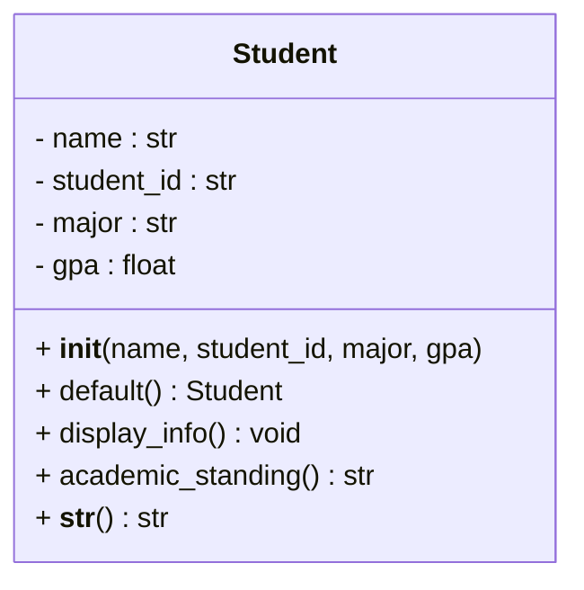

# Assignment 2 - Creating a class

I chose the Student entity.

It has four attributes: name, student_id, major and gpa.
There are two constructors - a parameterized one that fills all the fields, and
a default one (`Student()` or `Student.default()`) that leaves every field as
None. Besides `display_info()` the class has one more method,
`academic_standing()`, which decides Honours / Good standing / Probation from the
gpa.

`main.py` asks how many students to create, builds them with both constructors,
puts them in a list and calls `display_info()` on each.

UML class diagram:



(The same diagram is also in `student.puml`.)

Run:

```bash
python3 main.py
```
