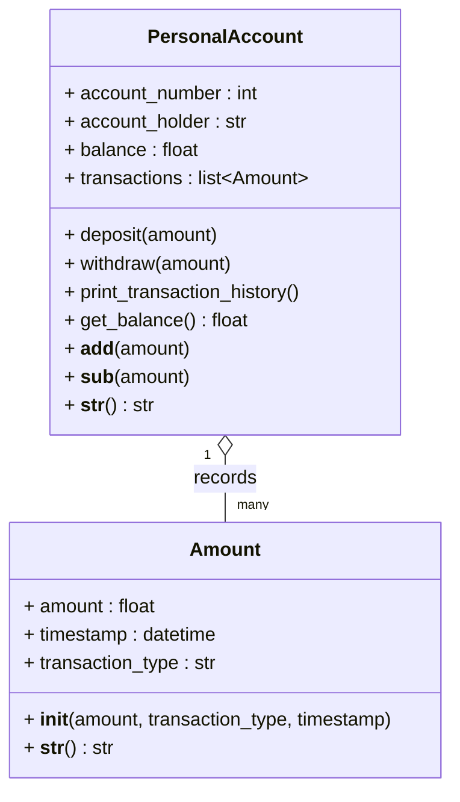

# Assignment 3 - Personal account

Two classes:

- `Amount` (amount.py) - one transaction: amount, timestamp and type
  (DEPOSIT or WITHDRAWAL).
- `PersonalAccount` (personal_account.py) - the account, keeps a balance and a
  list of Amount objects.

The balance starts at 0. `deposit()` adds an Amount of type DEPOSIT and raises
the balance, `withdraw()` adds a WITHDRAWAL and lowers it, but it does not let
you withdraw more than the balance. I also overloaded `+` and `-` so that
`account + 100` is the same as deposit and `account - 50` the same as withdraw.

`main.py` is a small demo (deposit, withdraw, check balance, print history).
Tests are in test_account.py.

UML:



Run:

```bash
python3 main.py
python3 -m unittest -v
```
