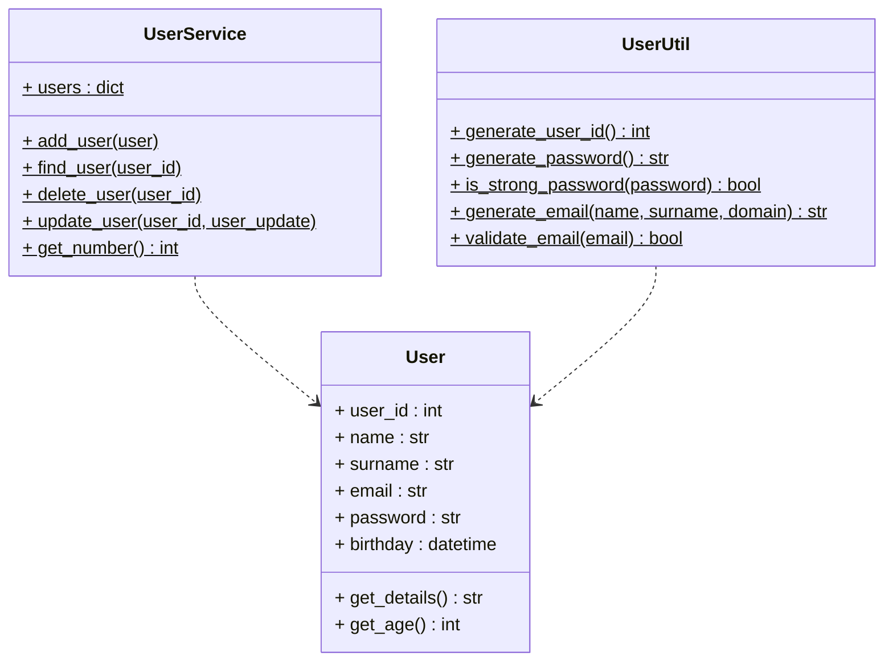

# Assignment 4 - User class methods

Three classes, each showing a different kind of method:

- `User` (user.py) - normal instance fields and methods (`get_details`,
  `get_age`).
- `UserService` (user_service.py) - a class attribute `users` (a dict) and class
  methods to add, find, delete, update users and count them.
- `UserUtil` (user_util.py) - only static methods.

What UserUtil does:

- `generate_user_id()` - 9 digits, first two are the current year (like 26...).
- `generate_password()` - at least 8 chars with an upper, a lower, a digit and a
  special character.
- `is_strong_password()` - checks the same rules.
- `generate_email(name, surname, domain)` - gives `name.surname@domain` in lower
  case.
- `validate_email()` - checks the `name.surname@domain.tld` format.

Tests are in test_users.py (TestUser, TestUserService, TestUserUtil).

UML:



Run:

```bash
python3 main.py
python3 -m unittest -v
```
