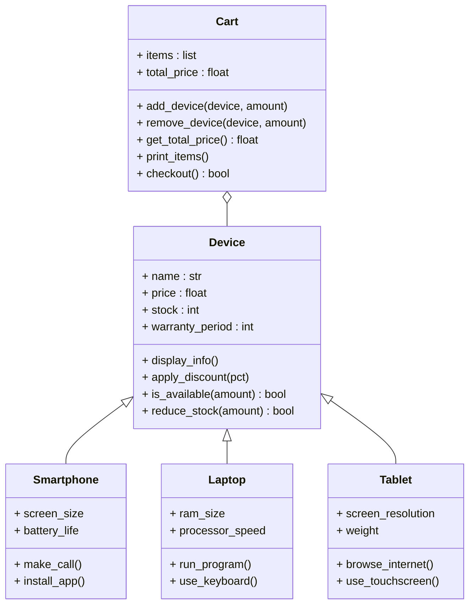

# Assignment 5 - Device shopping cart

Inheritance example.

- `Device` (device.py) - base class with name, price, stock, warranty and
  methods like apply_discount, is_available, reduce_stock.
- `Smartphone`, `Laptop`, `Tablet` (devices.py) - subclasses, each adds its own
  fields and methods and overrides display_info.
- `Cart` (cart.py) - holds (device, amount) pairs, can add/remove items, give the
  total price and checkout (it checks stock, lowers it and prints a receipt).
- `catalog.py` - 21 ready devices.
- `main.py` - the menu app: #1 show devices, #2 show cart, #3 exit.

Tests are in test_shop.py.

UML:



Run:

```bash
python3 main.py
python3 -m unittest -v
```
